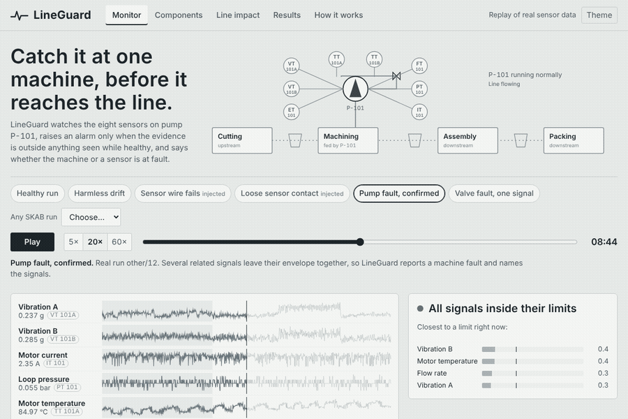
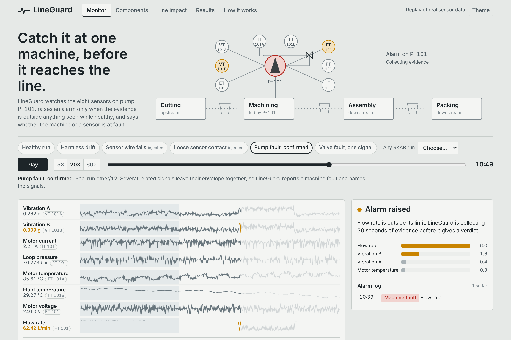
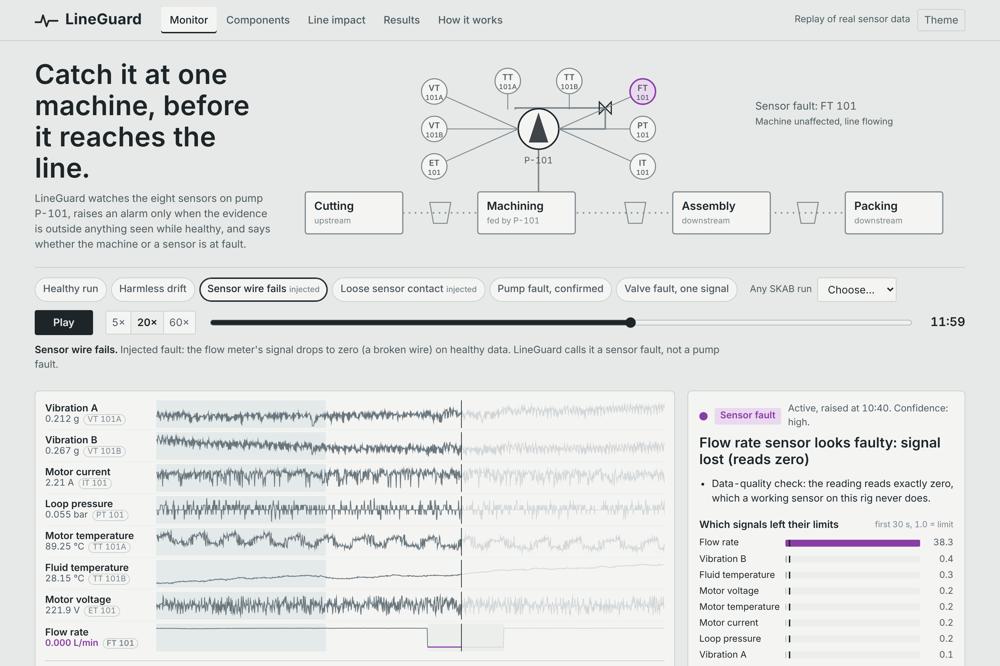
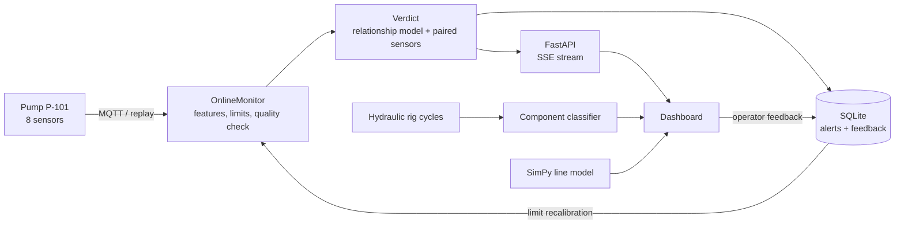

<div align="center">

# LineGuard

**Detect machine faults before they disrupt the production line.**<br>
Tells a failing machine from a failing sensor, and shows what the fault means for the line downstream.

[](https://github.com/AnshOP2008/LineGuard/actions/workflows/ci.yml)
[](LICENSE)



</div>

| Machine fault, confirmed | Sensor wire fails (injected) |
|---|---|
|  |  |

## Why

Small and mid-sized plants still watch machines with scheduled checks, an operator's ear, or one fixed alarm limit per sensor. Tight limits fire on harmless drift, loose limits miss early faults, and a broken sensor wire looks exactly like a broken machine. Nobody sees which downstream stations are at risk.

## What LineGuard does

| Step | What happens |
|---|---|
| **Sense** | 8 signals on a pump (2× vibration, current, voltage, pressure, flow, motor and fluid temperature), 1 Hz, over MQTT in the live service |
| **Learn** | The first 400 s after start-up are the healthy baseline. Each signal is judged by what is physically meaningful: *level* for flow, pressure, vibration and electrical signals; *rate of change* for temperatures, which drift during warm-up and settle at new levels after a fault |
| **Detect** | Calibrated per-feature limits, hysteresis, and a data-quality check for stuck or dead sensors. Strictly causal: every decision uses only the past |
| **Diagnose** | A cross-signal relationship model (LightGBM) and paired-sensor checks give one of three verdicts: **machine fault**, **sensor fault**, or **unconfirmed** with a two-minute check to settle it. On a hydraulic rig, a second model names the worn component and its grade |
| **Act** | Each alert becomes a prioritised work order (P1 machine, P2 unconfirmed, P3 sensor) with a checklist, tracked from Open to Closed; closing is checked against the data. A *Watch* state warns before the alarm. A SimPy line simulation shows what waiting costs downstream |

## Results (all regenerated by `python -m lineguard evaluate`)

**SKAB benchmark**: 34 real runs of a water-pump test rig, SKAB's own protocol (first 400 rows of each run = only training data). Hyper-parameters chosen by **nested leave-one-family-out cross-validation**, so no score below was tuned on its own test data.

| Model | F1 ↑ | FAR % ↓ | MAR % ↓ | Faults caught | Median delay | False-alarm events | Real-time |
|---|---:|---:|---:|---:|---:|---:|:---:|
| **LineGuard (balanced)** | **0.849** | 19.5 | **13.8** | 31/34 | **13 s** | 9 | ✅ |
| LineGuard (low-false-alarm) | 0.815 | 15.9 | 21.7 | 31/34 | 31 s | 18 | ✅ |
| PCA T² + Q (classic SPC) | 0.767 | 47.4 | 12.4 | 34/34 | 5 s | 125 | ✅ |
| Per-sensor limits | 0.761 | 35.2 | 20.0 | 32/34 | 16 s | 47 | ✅ |
| Conv-AE, causal (our re-impl., 3 seeds) | 0.767 | 25.9 | 23.8 | 32/34 | 73 s | 4 | ✅ |
| Conv-AE, as published (look-ahead) | 0.841 | 17.4 | 16.5 | 33/34 | 16 s | 2.7 | ❌ |
| *Best on the published SKAB leaderboard (Conv-AE)* | *0.78* | *13.55* | *28.02* | | | | ❌ |

- **Higher F1 than every entry on the published SKAB outlier-detection leaderboard** (0.849 vs 0.78), cross-checked with SKAB's own metric code.
- **14× fewer false-alarm events than classic T² + Q control charts** on the same runs.
- **Found while reproducing the leaderboard:** SKAB's reference notebooks align each 60-second window to its *first* row, so a flag at second *t* uses data up to *t + 58 s*. With that look-ahead removed, the best deep model drops from 0.84 to 0.77 F1 and its median delay from 16 s to 73 s. LineGuard is causal by construction (a unit test checks it).
- Early warning: a *Watch* state (health score above 0.8 of the limit for 10 s) is active during 0.8 % of healthy time and came before the alarm in 4 faults, a median of 67 s earlier.
- NAB changepoint score 27.4 (standard), 2nd on SKAB's changepoint leaderboard (best 32.4, Conv-AE 23.6).

**Sensor fault or machine fault?** 480 sensor faults injected into healthy data (6 types) plus all real SKAB faults, on a fresh random seed:

- 464/480 injected sensor faults raise an alarm (stuck 77/80 thanks to the data-quality check).
- **82 %** of stuck, dead, spiky or noisy sensors are identified as sensor faults, and the right sensor is named every time.
- Only **6 %** of real machine faults are wrongly dismissed as sensor faults.
- Offsets and slow drifts on one signal are physically indistinguishable from a real change at onset, so LineGuard reports them as *unconfirmed* and asks for a quick gauge check instead of guessing.

**Component diagnosis (UCI hydraulic rig, 2205 cycles, blocked 5-fold CV)**

| Cooler | Switching valve | Pump leakage | Accumulator |
|---:|---:|---:|---:|
| 99.8 % | 100.0 % | 97.2 % | 86.8 % |

The mildest wear grades (valve "small lag", pump "weak leakage") are caught in 100 % of cycles.

**Line impact (simulated):** at default assumptions, inspecting at the alert instead of running to failure saves ~130 good units and ~20 scrapped parts per shift. Every assumption is editable in the dashboard.

Full tables are in [`results/RESULTS.md`](results/RESULTS.md); machine-readable numbers are in [`results/results.json`](results/results.json).

## Try it

**Quick replay:** run `python -m http.server 8000 --directory web`, then open http://localhost:8000. Start with *Pump fault, confirmed*, then *Sensor wire fails*.

**Locally** (Python 3.10+):

```bash
pip install -r requirements-dev.txt
python -m lineguard all       # download data, evaluate, export dashboard data (~15 min)
python -m lineguard serve     # dashboard + live API on http://localhost:8000
python -m pytest -q           # 11 tests
```

**Full stack with MQTT:** `docker compose up` starts Mosquitto, the API and dashboard, a publisher that replays a SKAB run as a live pump, and an online monitor that prints alerts.

Optional deep baselines: `pip install torch` then `python -m lineguard evaluate --deep`.

## Architecture



```
lineguard/      detectors/ (LineGuard, baselines, deep), features, isolation, relationships,
                tuning (nested CV), robustness, hydraulic, simulation, online, evaluate, export
service/        FastAPI app (SSE stream, feedback, alerts), MQTT bridge
web/            static dashboard (no framework, no build step)
results/        generated metrics      tests/  pytest suite      docs/  decisions, submission notes
```

## What is real, injected or simulated

- **Real:** all SKAB signals and fault labels; all hydraulic-rig recordings.
- **Injected:** sensor faults, because SKAB has none labelled. They are marked wherever they appear.
- **Simulated:** the four-stage line and its costs.
- **Limits:** one lab rig with short runs (the baseline is only 400 s). Component diagnosis is validated on a different rig than the live stream. No plant pilot yet. Predictive maintenance itself is not new; the contribution is the combination, measured against clear baselines.

## Roadmap

Raw high-frequency vibration (FFT bands), ONNX export for edge gateways, operator-signalled set-point changes, a pilot with a local manufacturing unit, and multi-machine lines.

## Credits

- SKAB: Katser, I. D., & Kozitsin, V. O. (2020). *Skoltech Anomaly Benchmark (SKAB)*. Kaggle. doi:10.34740/KAGGLE/DSV/1693952 (GPL-3.0)
- Helwig, N., Pignanelli, E., & Schütze, A. (2015). *Condition monitoring of a complex hydraulic system using multivariate statistics*. I2MTC. UCI ML Repository, dataset 447 (CC BY 4.0)

AI coding assistance was used. Code: MIT. `web/data/` contains values derived from SKAB and the UCI dataset and remains under their licences.
